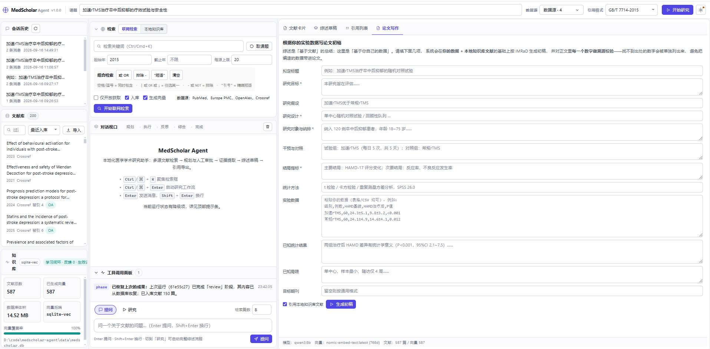
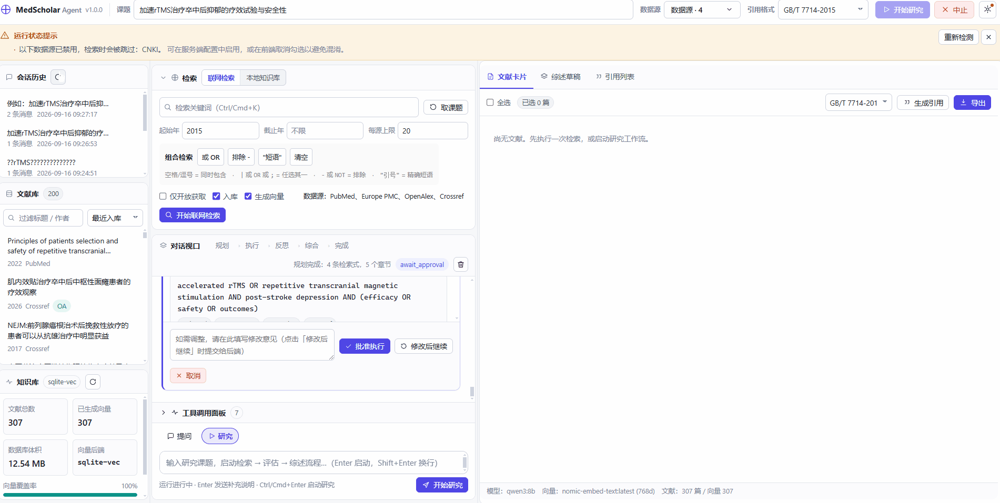
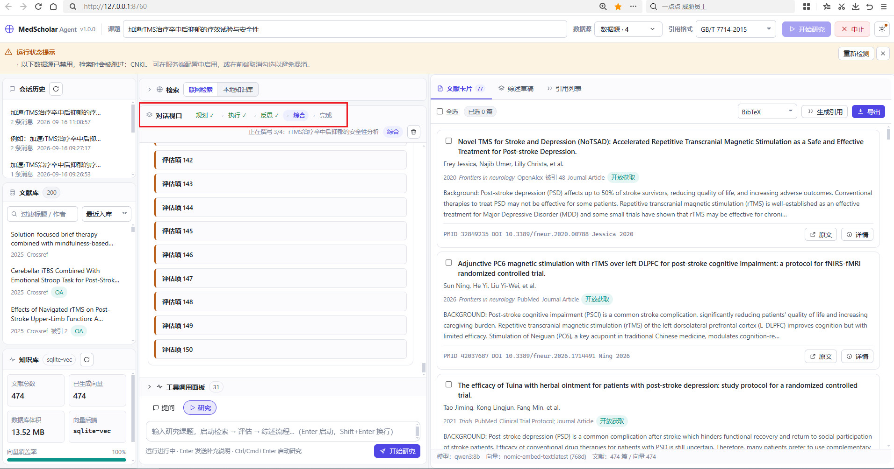
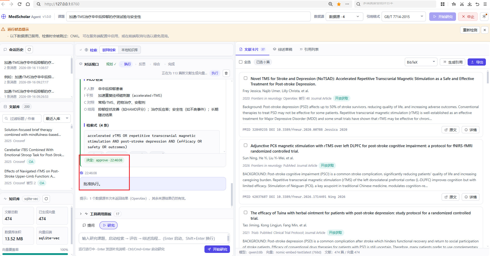
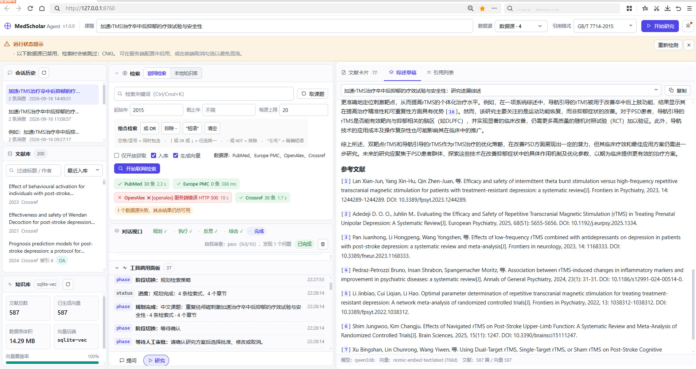
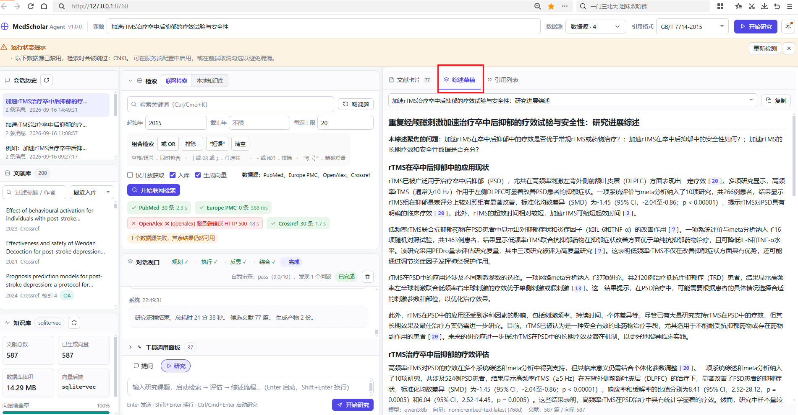

# MedScholar Agent

> A local-first academic agent for medical researchers. It searches the literature, builds a semantically searchable local knowledge base, assists with reviews and manuscript writing, and remembers your feedback.

[](https://github.com/arnoldli001/medscholar-agent/actions/workflows/ci.yml)

[中文](README.md) · **English**

## What It Is

**Making "AI-assisted writing" trustworthy, auditable, and reproducible in a medical context.**

The cost of failure in medical writing is academic misconduct. So the goal is not "how beautifully it generates" but **hallucination governance**: citations must resolve, numbers must have a source, and mistakes must be remembered.

---

## Screenshots

These screenshots come from an actual local run (`qwen3:8b` + `nomic-embed-text`) — not design mockups. They were captured at different times, so the knowledge base differs in size between them (474 → 587 papers); each caption states the size at capture time.

**主界面** (main interface)



The three-column workspace: session history and the local knowledge base on the left (paper count, vector coverage, backend type), retrieval and the dialogue viewport in the middle (the five stages Plan → Execute → Reflect → Synthesize → Done), and paper cards with provenance on the right (PMID / DOI / citation count / open access). At capture time the library held 587 papers and 587 vectors.

**医学论文辅助系统** (end-to-end demo)



The full pipeline, end to end (~4 min 26 s): enter a research topic → generate 4 queries → human approval → concurrent multi-source retrieval → ingest papers and build embeddings → fetch open-access full texts → produce the review. Partway through the recording OpenAlex returned HTTP 500; the UI flagged "1 data source failed; the remaining results are still usable" and the run continued to completion. The library held 307 papers at capture time.

**论文课题辅助研究系统思维链** (reasoning chain)



Stage-level observability: the stage bar at the top shows exactly where the run is (here, the "Synthesize" stage, writing section 3 of 4), while the dialogue viewport streams each assessment item as it completes. The library held 474 papers at capture time (it later grew to 587).

**规划 决策等链条** (planning and decision chain)



Planning plus human-in-the-loop approval: the PICO frame (Population / Intervention / Comparison / Outcome) and the four generated queries, with the **human approval gate** below — the run reaches the execution stage only after the researcher replies "approved", rather than running fully autonomously.

**调用工具面板、对话视口** (tool panel and dialogue viewport)



Tool-call panel and data-source health: latency and status for every source are visible line by line (here OpenAlex returned HTTP 500, and the UI states plainly that "1 data source failed; the remaining results are still usable"). The `phase` / `status` lines below are the stage-snapshot log that lets a run resume after a process restart.

**输出综述** (review output)



Review output and citation discipline: every `[n]` in the body maps one-to-one onto the reference list. The footer shows total runtime, 77 candidate papers, 2 generated artifacts, and the self-review score at completion (pass, 9.0/10).

---

## Repository at a Glance

| | |
|---|---|
| Size | Python ~40k lines (174 files), native frontend ~6.7k lines, 15 domain subpackages |
| Tests | **1384 tests, all green** · CI with 9 jobs (lint / test / eval / smoke / package / test-linux) |
| Architecture | Five layers (platform/domain/infrastructure/application/interface) + **AST-based architecture checks** (layer direction, circular dependencies, size limits — enforced in CI) |
| Retrieval evaluation | recall@k · nDCG@k · MRR · MAP + ablations across 7 configurations + a negative control; **the gate runs on every CI build** |
| Citation verification | Claim-level: reference existence · **numeric provenance** · **direction contradiction** · overclaiming · cross-lingual weak evidence. The verifier itself scores recall = 1.00 |
| Production readiness | trace/span · token and cost ledger · failure classification · retry/circuit-breaking/rate limiting · RAG injection defence · caching · schema migration · prompt versioning |

---

## System Architecture

Five layers, with dependencies pointing in one direction, enforced by an AST checker in CI and in pre-commit.

```
┌─────────────────────────────────────────────────────────────────────────┐
│ interface/    entry   server/ (FastAPI + uvicorn, 57 API routes)         │
│                       cli · mcp                                          │
├─────────────────────────────────────────────────────────────────────────┤
│ application/  orchest agent/ (Orchestrator + Scout/Reader/Critic/Writer) │
│                       Plan → Approve → Execute → Reflect → Synthesize;   │
│                       stage snapshots make runs resumable                │
│                       retrieval (hybrid search; the safety boundary)     │
├─────────────────────────────────────────────────────────────────────────┤
│ infrastructure/ adapt db/ (SQLite + FTS5 + sqlite-vec, 18 tables)        │
│                       api/ (10 data-source clients + rate limit/backoff) │
│                       llm/ (client + transport retry/circuit · JSON)     │
│                       embedding/ · importers/ · export/                  │
├─────────────────────────────────────────────────────────────────────────┤
│ domain/       domain  models · text (CJK segmentation) · query · citation│
│                       dedupe (zero I/O)                                  │
├─────────────────────────────────────────────────────────────────────────┤
│ platform/     cross   config · observability · resilience · security     │
│                       cache · prompts (versioned)                        │
│                       —— standard library only                           │
└─────────────────────────────────────────────────────────────────────────┘
```

### Real Violations the Layer Checker Caught

Dependency drift never shows up in a business diff, so review will almost always miss it. `scripts/check_arch.py` (~470 lines, pure AST, zero third-party dependencies) has already caught two classes of problem:

- A function inside `importers` (infrastructure layer) lazily loading `agent.reader` (application layer) — completely invisible from the file's import list.
- A circular dependency between `db.repo ↔ embedding.pipeline` — broken with dependency inversion: the data layer keeps only an empty hook and the embedding layer registers itself.

> As a side note, the checker once reported 27 false violations because of a bug in itself — which is enough to show how fragile "we agreed on it in the docs" really is.

---

## Production-Grade Design (Not "It Runs", but "We Can Debug It When It Breaks")

| Capability | Implementation and key design decisions |
|---|---|
| **Observability** | trace/span tree (contextvars keep concurrency isolated); an LLM usage ledger aggregated by model/stage/failure type, including CNY cost. **Successes and failures are both recorded** — recording only successes produces the illusion of "lovely average latency, terrible experience" |
| **Run state persistence** | An `agent_runs` table plus `run_steps` stage snapshots. Lists and details survive a process restart; at startup anything "running" is marked `interrupted` so nothing waits forever; with a snapshot in hand a run can resume from where it stopped |
| **Failure classification** | 11 classes (timeout / rate_limited / auth / bad_request / server_error / connection / parse / context_overflow / cancelled / unknown). "It failed 37 times" carries no information; "30 of those were 429s" points straight at rate limiting |
| **Resilience** | Full-jitter exponential backoff (prevents retry storms); circuit breaking isolated per backend and counting *calls* rather than *attempts*; token bucket allowing bursts; bulkheads capping concurrency. A 401 is never retried |
| **No retry once streaming** | Once tokens start flowing there is no retry — only during connection setup. Retrying makes the same passage appear twice |
| **RAG injection defence** | Retrieved abstracts and full texts are **untrusted data**: scan (Chinese and English instructions, zero-width characters, bidirectional control characters, base64 payloads) → wrap into a delimited data block stating that any instruction inside is void. The guard sits at the **single choke point** shared by all four paths, so one fix covers everything |
| **Secret redaction** | API keys and bearer tokens in logs and traces are redacted automatically (first 4 and last 2 characters kept, so they can still be reconciled) |
| **Caching strategy** | TTL + LRU + prefix invalidation + hit-rate statistics. **LLM generations are never cached**: users expect "regenerate" to produce something different, and a cache makes "where did this text come from" unanswerable |
| **Schema migration** | Versioned, with **checksums** (editing a released migration is an error), per-step transactions (a failure leaves no half-applied state), a backup before migrating, and dry-run |
| **Prompt versioning** | Version numbers plus variants (for A/B), validation after placeholder rendering (a single missed `{xxx}` otherwise slips silently into the context), and use counters |
| **PRISMA 2020** | Per-database identification counts come from real retrieval logs, so researchers do not have to count by hand; the researcher fills in exclusions and inclusions, and the tool only guarantees that **the numbers are internally consistent** and blocks on contradictions |

---

## Key Choices and Trade-offs

| Decision | Why not the framework | Cost / boundary |
|---|---|---|
| **A hand-written workflow instead of LangChain/LangGraph** | A fixed five-stage linear flow with one human approval point is not an arbitrary graph. The framework brings hundreds of MB of dependencies, implicit prompt assembly, and "when it breaks you don't know where". The hand-written `graph.py` is a few hundred lines and every stage is testable in isolation | No off-the-shelf checkpointer; snapshots and resumption had to be written (done). If dynamic branching or multi-agent negotiation arrives later, revisit an engine |
| **A single-file SQLite instead of Postgres/pgvector** | The target user is a **single-machine individual researcher** with no ops capacity, whose backup strategy is "copy one file". At tens of thousands of papers, sqlite-vec is plenty | Single writer for concurrent writes; beyond ~1M vectors it struggles. This is the reasonable boundary of a personal tool |
| **sqlite-vec with a pure-Python fallback instead of FAISS** | A friend's machine may lack the VC runtime, so the native extension fails to load. **Availability beats peak performance**: if loading fails, fall back to pure-Python cosine search | The fallback is slow at scale, but "degraded but working" beats "crashes on startup" |
| **Build-free native JS instead of React/Vite** | A friend should be able to unzip and run without a Node toolchain. Native JS is enough for a three-column interaction | Component reuse relies on hand-written conventions. The trade-off picks distribution cost over developer experience |
| **In-process asyncio with snapshots instead of Celery** | On a single machine for a single user, a broker only adds operational burden. The real requirement is "don't lose progress on restart", which snapshots solve | A process crash loses the current stage's intermediate results; no cross-machine load balancing |
| **Filter citations, then renumber contiguously** | Renumbering after filtering avoids gaps that would misalign body `[n]` markers with the reference list | Costs an extra validation pass; buys strict one-to-one correspondence |
| **A dual-track Critic (heuristics + LLM)** | Heuristics score on **verifiable signals** — publication type, study-design keywords, sample size, citation count, recency — so they never hallucinate and work offline; the LLM only supplements "core findings / limitations" | Heuristics are insensitive to subtle domain differences, and the fusion weights are empirical rather than systematically tuned (exactly what the evaluation harness is meant to fix) |
| **Numeric provenance checking (manuscript module)** | Fabricating a P value in a medical paper is misconduct. Prompts are probabilistic constraints; **programmatic checking is a deterministic one**: every number in the body has to be traced to the source material, and anything untraceable is listed | It produces false positives (paraphrases, unit conversions), but for anti-fabrication a false positive is preferable to a miss |
| **A hand-written architecture checker** | Dependency drift never shows up in a business diff, so review inevitably misses it. ~470 AST lines cover three dimensions with zero third-party dependencies | Rules and allowlists need maintenance, and the allowlist may only ever shrink — otherwise it degrades into a decoration |

---

## The Deep End: 13 Real Bugs We Hit

Recorded as symptom → root cause → fix → verification.

### 1. Chinese search was completely broken (FTS5 treated a whole run of Han characters as one token)

**Symptom**: Hundreds of Chinese papers in the database, yet searching for "抑郁" (depression) returned nothing. English worked fine.

**Root cause**: SQLite FTS5's `unicode61` tokenizer treats consecutive CJK characters as a **single token**. `卒中后抑郁` is one token, so the query `抑郁` cannot match it.

**Fix**: Segment at the character level on **both** the indexing and query sides (`segment_cjk` inserts spaces between Han characters), and use phrases (`"抑 郁"`) on the query side to restore substring semantics. On top of that, a three-level fallback cascade (phrase → bigram → bigram-OR) prevents a long exact phrase failing to match from returning nothing at all.

**Verification**: `test_db.py` covers "a Chinese fragment appearing inside a longer phrase"; `test_textutil.py` pins down the three modes of `build_match_query`.

### 2. 78 papers embedded for 15 minutes without producing a single vector (cross-event-loop deadlock)

**Symptom**: The embedding pipeline hung, CPU time sat at 1.3s (essentially zero), and the logs showed no error.

**Root cause**: A cached `httpx.AsyncClient` connection pool is **bound to the event loop that created it**. Tests and the service reused it from different loops in turn, so requests hung forever.

**Fix**: The client records `_client_loop` and validates loop ownership before every request, rebuilding when it does not match; the embedding provider was changed to **create a short-lived client per call**.

**Verification**: 78 papers ingested with all vectors generated in **1.6 seconds**.

### 3. "AI writes the paper" almost put a fabricated P value into the manuscript

**Symptom**: A draft contained "a decrease of 4.2 points" and "n=128" that the user had never supplied.

**Root cause**: The LLM's completion tendency. Fill-in-the-blank phrasing in medical writing ("HAMD decreased by __ points after treatment") invites the model to invent plausible-looking numbers, and a system prompt alone is not reliable.

**Fix**: `check_number_provenance()` extracts every number from the body with regex and traces each one to either the user-supplied data or the local literature; `12%` and `12` count as equivalent. Anything untraceable is listed together with the sentence it appears in, and the result is `pass/warn/fail`.

**Verification**: `test_learning_and_manuscript.py` uses "the fabricated 4.2 points" and "9999 cases" as regression cases.

### 4. The planning stage crashed intermittently: `'list' object has no attribute 'get'`

**Symptom**: Roughly one run in three raised this error during planning, then silently degraded to a template outline.

**Root cause**: **Surface**: after object parsing failed, `extract_json` fell back to "the first balanced `[...]`", so a nested array was returned as the whole answer and every other field was lost. **Deeper**: the model used unescaped double quotes inside a query string, and after `"query": "("` it fell into a whitespace loop that burned the entire token budget.

**Fix**: (1) Make `extract_json` **shape-aware** — if the text starts with `{`, only accept an object and never mistake a nested array for the answer; (2) truncation repair (back off to the last complete value and close the brackets); (3) `chat_json(expect="object")` validates the top-level type and triggers a corrective retry when it does not match; (4) add `exc_info=True` to the logs (previously only `%s`, so the raise site could not be located).

**Verification**: Regression cases built from **two genuinely captured bad outputs** (a truncated one and a malformed one). After the fix, the production Plan node reported `state.errors=[]` and reliably produced 3 queries plus a 5-chapter outline.

### 5. The model kept reloading, taking longer than generation itself

**Symptom**: Planning took "sometimes 20 seconds, sometimes 6 minutes".

**Root cause**: (1) Ollama's default `keep_alive` is 5 minutes, and reloading an 8B model after eviction takes 60–120 seconds. (2) More insidiously, `num_ctx` is a budget shared between prompt and output; a 15,676-character digest once consumed 4,129 tokens and squeezed the output down to a few hundred characters.

**Fix**: (1) Set `keep_alive: 30m` explicitly, record `load_duration`, and warn when loading exceeds 20 seconds. (2) `_fit_digest()` **shrinks the material in steps** within budget (abstracts 800→500→400→300→200 characters; paper count unlimited→18→12→8), protecting body length first. (3) Add `estimate_tokens()` for budget estimation (8% error).

**Verification**: Planning wall-clock dropped from 5–6 minutes to **22.6 seconds**. At `num_ctx` 8192/4096/2048 throughput measured 46.7/46.5/46.9 tok/s (no difference), which rules out the hypothesis that a smaller context is faster.

### 6. We computed the hardware ceiling, so we stopped fiddling

**Symptom**: The local 8B model was slow, and the suspicion was program inefficiency.

**Root cause**: `nvidia-smi` showed memory at 100% and SM clocks at full — memory bandwidth was saturated. An RTX 4060's 272 GB/s divided by a 6.19 GB model gives a theoretical ceiling of **~44 tok/s**; measured 45–47.

**Conclusion**: Generation is a bandwidth-bound serial process, so concurrency only queues up. Attention moved to "time that produces no value" (model loading, retries on bad output, serially waiting on the network) and to "how many tokens get generated" (length ranges, material trimming).

### 7. Multiple queries waiting on the network serially (pure waste)

**Symptom**: Four queries each waited 7–10 seconds, making one retrieval round over 30 seconds.

**Root cause**: Multiple data sources within a single query were already concurrent via `asyncio.gather`, but **the queries themselves** were awaited serially.

**Fix**: Make the queries concurrent too (semaphore of 3) while **reassembling results in the original order**, so log, statistics, and UI event ordering stay deterministic.

**Verification**: Four queries went from 32.7s serially to about **10.5s**.

### 8. The frontend was fixed, but the user was still running the old JS

**Symptom**: A bug was already fixed, but the user kept reproducing the old error.

**Root cause**: (1) The browser had cached the old `app.js`; `Cache-Control: no-store` prevents re-caching but does nothing about an already-cached copy. (2) UTF-8 Chinese in a `.bat` file got mangled by cmd's code page 936, and LF line endings broke `goto` and labels.

**Fix**: (1) When rendering `index.html` server-side, append a `?v=` version derived from each static file's mtime, plus `no-store`. (2) Make all `.bat` files **pure ASCII with CRLF**, moving Chinese messages into Python (which emits them correctly via `WriteConsoleW`).

### 9. In XML/HTML, every field that "looked right" was wrong

**Symptom**: After importing a Web of Science export, every DOI was empty, so deduplication failed and full-text retrieval failed entirely.

**Root cause**: **WoS uses `DI` for DOI, while the RIS spec says `DO`**; the journal name is `SO` (not `JO`) and pages are `BP/EP` (not `SP`). Plain-text exports have no hyphens and multi-author entries continue on indented lines — parsing them by the standard RIS rules reads nothing at all, or glues three authors into one name.

**Fix**: Complete the tag mapping; treat continuation lines differently per field (for repeatable fields a continuation is a new item, for single-value fields it is concatenation); make format detection rely on **content features before file extension**.

**Verification**: `test_importers.py` uses real export styles from five databases as test cases.

### 10. Unpaywall rejects placeholder email addresses

**Symptom**: Looking up open-access full text by DOI returned HTTP 422.

**Root cause**: Unpaywall **validates that the email is real** and explicitly rejects `example.com`.

**Fix**: Catch the 422 and turn it into an actionable Chinese message (go fill in `sources.unpaywall.email`), while also telling the user they can simply set `enabled: false`. An unavailable external dependency should not become a blocking failure.

### 11. The guard script crashed in a Chinese Windows pipe

**Symptom**: A `.bat` verification script crashed with `UnicodeEncodeError: 'gbk' codec can't encode character '\u2713'` — on the very line reporting that verification passed.

**Root cause**: Three layers stacked. (1) The script printed `✓`, which is not in GBK. (2) A real console does not take this path (`WriteConsoleW` bypasses the encoding); only **redirection or piping** encodes as cp936. (3) CI runs on UTF-8 Ubuntu, so it could never find this.

**Fix**: `sys.stdout.reconfigure(encoding="utf-8", errors="replace")`, plus a **real subprocess regression test**: force a non-UTF-8 pipe with `PYTHONIOENCODING=gbk` and assert exit code 0 with no `UnicodeEncodeError` on stderr.

**Lesson**: A checking tool with no tests of its own means trusting it while never having verified it.

### 12. Material indices were silently reordered

**Symptom**: While writing a citation-fidelity test asserting that "indices in the material must match the explicit indices", it failed immediately: passing `[(1, A), (3, B)]` produced `[1] A` and `[2] B`.

**Root cause**: `digest_papers`, underneath `build_context_digest`, only ever **incremented from `start_index`** and ignored the caller's `__index__` entirely. After the Critic filtered to a subset, the indices were misaligned.

**Impact**: What the model called "paper 2" was attached to the paper actually numbered 2, which might not even be in the material — so critiques were lost, or **a negative critique was pinned on an unrelated paper**.

**Fix**: `digest_papers` uses `__index__` when the data carries it and falls back to sequential numbering otherwise, with a regression test (passing indices with gaps).

**Lesson**: A contract written down in the docs must have a test guarding it — otherwise it quietly diverges from the implementation and downstream code pays for it.

### 13. The architecture checker's own false positives

**Symptom**: The checker initially parsed a package's `__init__.py` as an ordinary module and reported 27 false violations.

**Conclusion**: False positives drown out real problems, so the parsing logic was verified separately; and the checker must **report rather than crash** when the code under test has a syntax error.

---

## Performance and Quality (Measured)

> On another machine, re-measure with `scripts/bench_models.py` and `scripts/check.py`.

### Non-LLM stages: hardly ever the bottleneck

| Stage | Measured |
|---|---|
| Embedding (`nomic-embed-text`, 768 dimensions) | ~60 items/second |
| 78 papers ingested + all vectors generated | **1.6 seconds** |
| Cross-database retrieval (4 sources concurrent) | **2–3 seconds** |
| One retrieval round with concurrent queries | ~**10.5 seconds** (32.7 seconds serially) |

### LLM stages: the hardware ceiling is computable

| Scenario | Generation speed | Planning wall-clock |
|---|---|---|
| Pure CPU (`qwen3:8b`) | ~7.4 tok/s | 48 seconds |
| **RTX 4060 (`qwen3:8b` Q4)** | **45–47 tok/s** | **22.6 seconds** |

An RTX 4060's 272 GB/s of memory bandwidth divided by a 6.19 GB model is a theoretical ceiling of **~44 tok/s**, and 45–47 was measured — so this is already the hardware limit. That settles it: neither concurrency nor tuning `num_ctx` (measured 46.7/46.5/46.9 tok/s at 8192/4096/2048, no difference) will make it faster. The optimization budget therefore went to where waste actually was:

| Waste | Optimization | Gain |
|---|---|---|
| Model reloads after eviction | `keep_alive: 30m` | Saves 60–120 seconds each time |
| Prompt eating the output budget | `_fit_digest()` steps the material down | The body is no longer squeezed to a few hundred characters |
| Retries on bad output | Shape-aware parsing + truncation repair + corrective retry | Planning went from "intermittent crash" to reliably successful |
| Queries waiting serially | Concurrency across queries (semaphore 3) | Saves ~22 seconds per round |

### End-to-end timing

| Metric | Measured |
|---|---|
| Full "topic → review" (local GPU) | ~5–10 minutes |
| Review body length | Default target 4000–8000 characters (configurable 800–40000); 1192 characters per section (default tier) / 2195 (large-length tier) |
| Citation consistency | Body `[n]` markers map strictly one-to-one onto the reference list; out-of-range citations are removed automatically |

### Retrieval quality

```bat
:: Same as CI: deterministic offline regression + threshold gate (seconds, no Ollama needed)
.python\python.exe scripts\eval_retrieval.py --dataset regression --k 10 --embed-provider hashing --check

:: Real evaluation on this machine: run it against your own library (requires Ollama)
.python\python.exe scripts\eval_retrieval.py --from-library --limit 60 --k 10 --mode title-terms
```

Metrics: recall@k / precision@k / MRR / MAP / nDCG@k, with an ablation matrix across 7 configurations.

**Measured (local library of 60 papers, `nomic-embed-text`, title-terms, @10)**:

| Configuration | recall@10 | nDCG@10 | MRR | vs. BM25 |
|---|---|---|---|---|
| bm25-only | 1.0000 | 0.9754 | 0.9667 | — |
| vector-only | 1.0000 | 0.8967 | 0.8611 | **−7.9pt** |
| production (RRF k=60) | 1.0000 | 0.9815 | 0.9750 | **+0.6pt** |
| weighted-fts2 (BM25 ×2) | 1.0000 | 0.9877 | 0.9833 | **+1.2pt** |

**This table says three things, and two of them are criticisms of the project itself**:

1. Fusion really does beat either single path — production beats bm25-only and vector-only.
2. **The vector-only path is clearly weaker than BM25** (nDCG −7.9pt): the corpus is English medical literature and the queries are derived from titles, so lexical overlap stays high and the semantic path gains nothing. "Adding vector search is always better" is false.
3. **recall@10 saturates at 1.0 across the board, so it has no discriminating power** — with 60 papers, top-10 essentially covers every relevant paper. On small corpora, look at nDCG/MRR, not recall.

**Negative control**: A deliberately irrelevant query (quantum chromodynamics) genuinely has no relevant papers in the corpus, yet the production configuration still returned 10.0 results (= top_k). RRF fusion inherently always produces an answer, with no exit for "I don't know" — the retrieval layer alone cannot reject an irrelevant question, so this must be caught downstream by out-of-range citation removal and numeric provenance checking.

### Claim-level citation support verification

```bat
:: Check the most recent review in the library
.python\python.exe scripts\eval_faithfulness.py --from-db
:: Add per-claim LLM judgement (recommended for cross-lingual cases)
.python\python.exe scripts\eval_faithfulness.py --from-db --llm
```

**Tier 0 (deterministic rules, offline, runs in CI)**: existence · numbers · direction · overclaim · grounding · cross_lingual.

**Tier 1 (`--llm`)**: the LLM judges each claim as `supported/partial/unsupported/contradicted` with a reason and the source evidence; `--self-consistency` asks twice and marks disagreements `uncertain`.

**Measured (a real review, 21 cited claims)**:

```
weakly_supported 21
Note: all 21 passed checks based purely on language-independent signals
      (numbers/terms/abbreviations); 0 could not be verified for lack of a
      shared signal. Semantic support requires Tier 1.
```

> `weakly_supported` was forced into existence by measurement: the original design abstained on anything cross-lingual, and as a result **17 of 21 claims in the same review landed in "cannot verify"**. A Chinese review citing English literature is the normal case, so a verifier that abstains on the main scenario is no verifier at all. The fix was to restore judgement using language-independent signals.

**The verifier was itself measured** (a 27-item human-annotated set): 88.9% agreement, expected rules fired 20/20, **binary recall = 1.00 (zero misses), precision = 0.89**, and P = R = 1.00 on the `contradicted` class. The CI gate requires recall to be exactly 1.0.

**Known blind spots**: semantic paraphrase (same-language hypernym substitution) is falsely flagged because lexical overlap is too low; cross-lingual cases sharing no terminology at all are abstained on (missed). These two are precisely why Tier 1 / NLI is needed, and they are **deliberately kept in the annotated set and measured continuously rather than hidden**.

---

## Quick Start

On Windows, double-click **`run.bat`**. It locates Python, checks dependencies, generates a config, starts the service, and opens the browser.

For first-time use:

1. Double-click **`run-doctor.bat`** for an environment self-check — it reports item by item whether the LLM, the embedding model, and each data source are ready.
2. Make sure Ollama is running and the models are pulled:
   ```bat
   ollama serve
   ollama pull qwen3:8b
   ollama pull nomic-embed-text
   ```

### If You Want It Faster

| Approach | Effect | Cost |
|---|---|---|
| A smaller model: `llm.model: qwen3.5:4b` | About 2× | Slightly lower quality |
| Lower `agent.critique_max_papers` (12 → 6) | Halves critiquing time | More papers can only use heuristic scoring |
| **Switch to the DeepSeek cloud API** | **An order of magnitude faster, better quality** | Needs a key, pay per use (under ¥0.10 per review) |

> Don't switch to a smaller model just because of tok/s: `llama3.2:3b` is 5× faster but writes the placeholder `[n]` straight into the body — it looks cited but does not match the reference list. Review writing demands **citation discipline** more firmly than speed.

---

## Documentation Index

| Want to know | Read |
|---|---|
| The full architecture and 10 ADRs | [`docs/ARCHITECTURE.md`](docs/ARCHITECTURE.md) |
| Retrieval evaluation method, ablation results, and "what this evaluation cannot prove" | [`docs/EVALUATION.md`](docs/EVALUATION.md) |
| The HTTP contract | [`docs/API.md`](docs/API.md) (`scripts/smoke_http.py` checks it route by route) |
| Verification method and a record of real defects | [`docs/VALIDATION.md`](docs/VALIDATION.md) |
| Script usage | [`scripts/README.md`](scripts/README.md) |

---

## Compliance Statement

Our university's electronic resource policy explicitly forbids bulk downloading, and publishers respond by blocking **the entire university's** IP range. This project **does not scrape subscription resources**; it offers four compliant alternatives: record import / official bulk packages / a local Zotero library / link-resolver hand-off. It is technically possible, but the consequences would fall on the whole university — so we deliberately gave up that path.

---

## License

MIT License
